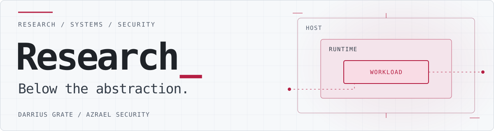

<picture>
  <source media="(prefers-color-scheme: dark)" srcset="assets/banner-dark.svg">
  <source media="(prefers-color-scheme: light)" srcset="assets/banner-light.svg">
  
</picture>

# Security research

**Original analysis · Reproducible evidence · Defensive guidance**

The raw research behind [Azrael Security](https://azraelsecurity.vercel.app), by [Darrius Grate / `@CR1MS0N-Operator`](https://github.com/CR1MS0N-Operator). I investigate where security boundaries fail, document the conditions that make a finding reachable, and explain what changes the result.

GitHub is the canonical home for full research, lab evidence, figures, and technique notes. The site is the editorial layer for selected blog posts and executive reports from the top 3–10 research pieces—not a replacement for the sources here. See the [publishing model](docs/MIGRATION.md) for scope and current status.

[Read the whitepaper](research/container-boundaries/README.md) · [Browse publications](#published-work) · [Research policy](SECURITY.md)

## Published work

### 01 / [Below the Abstraction](research/container-boundaries/README.md)

**Hook Isolation Failures in the NVIDIA Container Toolkit** · Whitepaper 1 · Published April 12, 2026

An analysis of the CVE-2024-0132 → CVE-2025-23359 → CVE-2025-23266 chain, extending prior NVIDIA container research to rootless Podman and the runc/crun runtime boundary.

- **Scope:** four tested configurations, with vulnerable and patched behavior documented.
- **Result:** the tested rootless crun path inherits the unsafe hook environment; runc does not.
- **Defense:** patch verification, runtime-specific limitations, and monitoring guidance accompany the evidence.

`Linux` `Podman` `OCI hooks` `NVIDIA` · [Full paper & figures](research/container-boundaries/README.md) · [Defensive guidance](research/container-boundaries/README.md#section-7-defensive-guidance)

### 02 / [StackSmash re-2](techniques/linux/re/re-2/README.md)

**Tracing a stripped ELF validator** · Technique writeup · Published February 8, 2026

A worked analysis of a 64-bit Linux binary: format checks, hex decoding, and an XOR/OR comparison traced with static and dynamic tools. Includes validation evidence, redacted challenge material, and defensive notes.

`Reverse engineering` `ELF` `GDB` `ltrace` · [Read the writeup](techniques/linux/re/re-2/README.md)

## Below the surface

**[StackSmash re-1 — investigation notes](techniques/linux/re/re-1/README.md).** Early reconnaissance of a 32-bit PIE ELF binary. Analysis and outcome remain work in progress; this is not listed as a completed publication.

Only existing material is indexed here. Planned kernel, identity, and infrastructure tracks are not presented as published research. The [content inventory](docs/CONTENT-INVENTORY.md) records what is available.

## How to read the research

1. **Start with the question.** Read the abstract, scope, and tested configurations.
2. **Follow the evidence.** Environment versions, source references, figures, and negative results matter as much as successful reproductions.
3. **Read the defense.** Check patch behavior, deployment constraints, and monitoring before applying a conclusion to another environment.

All work is conducted on self-operated, authorized lab infrastructure. No production testing or unauthorized scanning. Publication and redaction boundaries are defined in the [security policy](SECURITY.md).

Methodology &amp; reproducibility

Research follows five steps: establish the expected baseline, identify the enforcement boundary, vary one condition at a time, map the impact, and document the result with defensive guidance.

Each finding should identify the exact OS, kernel, runtime, and toolkit versions used. Host-dependent conditions, negative results, and pre-/post-patch behavior are recorded alongside positive results. A finding is evidence for the tested environment—not a claim that every deployment behaves the same way.

The whitepaper documents the container lab and version pins in its [methodology section](research/container-boundaries/README.md#methodology). For document templates and review requirements, see [Architecture](ARCHITECTURE.md) and [Contributing](CONTRIBUTING.md).

## Repository guide

| Destination | What you will find |
|---|---|
| [Container boundaries](research/container-boundaries/README.md) | Whitepaper, CVE chain, lab results, and six figures |
| [Reverse engineering](techniques/linux/re/) | One completed writeup and one set of investigation notes |
| [Content inventory](docs/CONTENT-INVENTORY.md) | Tracked research, evidence, and supporting assets |
| [Publication catalog](publications.json) | Dated public entries for profile and site consumers |
| [Publishing model](docs/MIGRATION.md) | GitHub sources and the site's editorial role |
| [Architecture](ARCHITECTURE.md) · [Contributing](CONTRIBUTING.md) | Layout, document formats, and review process |
| [Security](SECURITY.md) · [Changelog](CHANGELOG.md) | Publication boundaries and repository history |

## Related work

[NightForge](https://github.com/CR1MS0N-Operator/nightforge) is the reproducible operator workstation behind this research. [C4](https://github.com/CR1MS0N-Operator/c4) is the infrastructure lifecycle CLI. [Lant3rn](https://github.com/CR1MS0N-Operator/Lant3rn) focuses on Active Directory permission auditing.

---

Research below the abstraction. Evidence before claims.
